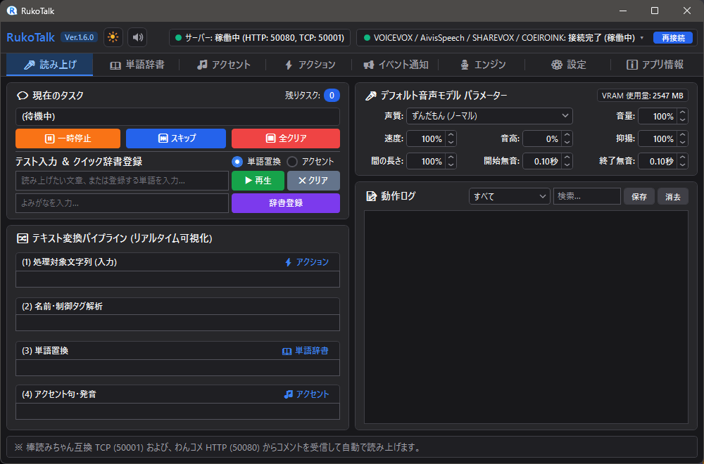
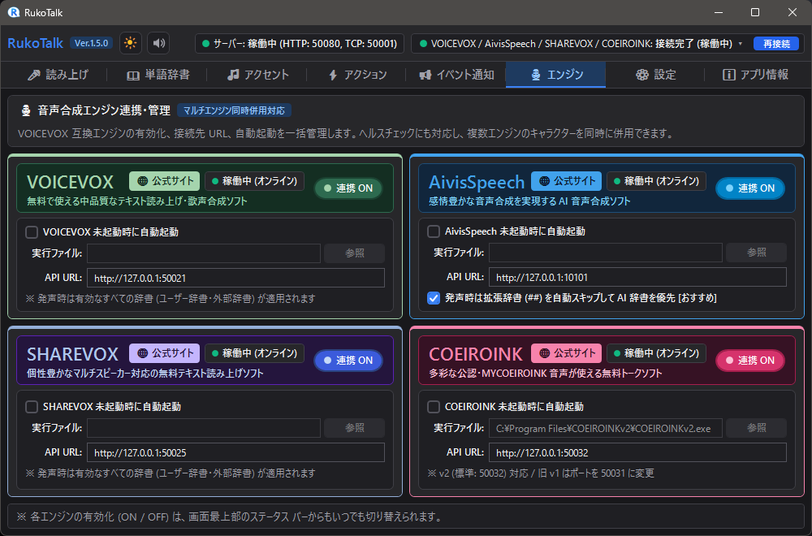
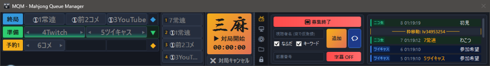

# Pandora-Box

※本リポジトリには自作アプリの成果物（実行ファイル等）のみを置いています。ソースコードは含みません。  
※基本的に自分用に作成したものであり、私の都合に合った仕様となっていることをご理解ください。  
※無保証です。本リポジトリの公開物を利用したことによるいかなる損害についても責任を負いません。  
※実行ファイルはセキュリティ機能に誤検知される場合があります。[VirusTotal](https://www.virustotal.com/gui/home/upload) 等をご活用ください。  
※Windows 11 Pro 26H2 用に最適化しています。動作には [.NET 10.0 デスクトップ ランタイム (x64)](https://dotnet.microsoft.com/ja-jp/download/dotnet/10.0) が必要です。  
※日本語化パッチ等は [Toy-Box レポジトリ](https://github.com/Rukoto/Toy-Box) および [Study-Room レポジトリ](https://github.com/Rukoto/Study-Room) を参照ください。

---
## 「RukoTalk Ver.1.5.1」
「棒読みちゃん」の後継として設計された、現代の配信環境に最適化された Windows 向けテキスト読み上げ (TTS) アプリです。  
棒読みちゃんと完全互換の HTTP / TCP 連携およびコンパニオン ブリッジ (BouyomiChan.exe) を備えており、「NCV」や「わんコメ」等の既存設定を変更することなくそのまま VOICEVOX や互換エンジンの高品質な音声合成へ移行できます。  
秒間数十件の弾幕コメントが殺到しても UI が固まらない非同期パイプラインを採用し、「安定化 ＞ 軽量化」を最優先方針として開発されています。個人・法人問わず、収益化配信や商用動画制作でも完全無料でご利用いただけます。

- **棒読みちゃん完全互換（設定変更ゼロで移行）**: HTTP (50080) / TCP (50001) 送信、NCV プロセス監視パス、(s150) 速度・(t120) 音程・(v80) 音量・(voice 2) 声質などの各種制御タグに対応
- **4 大音声合成エンジンの「同時併用」に対応**: VOICEVOX、AivisSpeech、SHAREVOX、COEIROINK との直接通信・同時併用に対応。エンジン未起動時の自動起動（パス自動検出付き）や、AivisSpeech 発声時の文脈 AI 辞書（BERT）自動優先機能を搭載
- **配信を止めずに「その場で」イントネーション＆辞書修正**: 動作ログの右クリックやクイック登録欄から、配信中でも即座に単語置換やアクセント核（拍数・語尾上げ）を試聴しながら登録・修正可能。テキスト変換パイプラインもリアルタイム可視化
- **誤爆しない！充実の配信特化型辞書を標準同梱**: 基本辞書、日本語読み補正、英字固有名詞、英語略称、ゲームタイトル、麻雀用語辞書を標準収録。短い英字略称（AI, FPS, OBS 等）が英単語の途中で誤爆しない境界保護設計
- **弾幕・混雑に強いスマート制御**: 長文カット、自動加速、古い未読の自動スキップ、AA（アスキーアート）・連投コメントの自動スキップ、匿名コメント優先スキップ、リスナーによる教育・忘却コマンド（配信者登録語句は保護）を搭載
- **配信者向け便利機能**: 特定キーワードでの SE 再生・ボイス切替・全文置換（⚡ アクション）、ギフト・広告等の読み飛ばし保護（📢 イベント通知）、OBS 向け仮想オーディオ出力デバイス個別指定、読み上げミュート中の着信チャイム通知、キャラクター別の音量バランス補正に対応

配布・ダウンロード: [BOOTH からダウンロード (無料 / ドネーションウェア)](https://rukoto3.booth.pm/items/9117715)

---
## 「MQM Ver.1.1.0」
YouTubeを始めとした麻雀配信において、視聴者参加型の対局予約・待機列・枠管理をスムーズに行う配信支援アプリです。  
コメント ビューアーである「NCV」や「わんコメ」にプラグインをご右乳することでリアルタイムに連携し、コメントからの自動予約や参加枠の進行管理、OBS 等へのテロップ出力を一元化します。

- **プラグイン完全内蔵 ＆ ワンクリック導入**: NCV 用・わんコメ用の連携プラグインを MQM.exe 本体に完全内蔵しており、初回起動時や設定画面からワンクリックで自動導入・更新が可能
- **コメント自動予約 ＆ 直感的な枠操作**: 予約キーワード検知による自動登録、ダブルクリックでの予約・待機枠移動、ボタンやドラッグでの並び替え、四麻 (◆) / 三麻 (▼) の個別・一括切替に対応
- **OBS / nAir 連携テロップ自動出力**: 部屋番号 (MQM_room_id.txt)、準備中・対局中（LIVE）の状況に応じた予約字幕テロップ (MQM_subtitle.txt)、募集終了案内 (MQM_closed.txt) をリアルタイムにファイル出力
- **セッション自動復元 ＆ テスト機能**: 不意の再起動時でも対局・予約状態を保持するセッション復元機能や、各配信サイトの模擬コメントを送信できるコメント テスターを搭載

ダウンロード (x64): [MQM_v1.1.0_win-x64.zip](https://github.com/Rukoto/Pandora-Box/releases/download/MQM-v1.1.0/MQM_v1.1.0_win-x64.zip)
